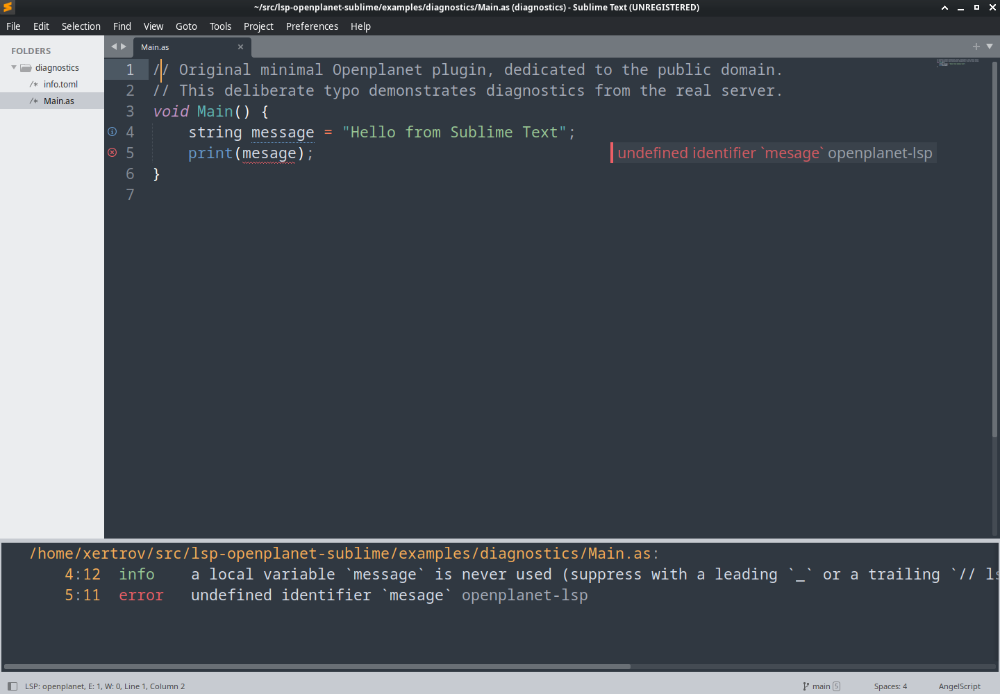

# Openplanet in Sublime Text

Use completions, diagnostics, hover, definitions, references, and rename for Openplanet AngelScript through the Sublime LSP package. Plugin `info.toml` files keep TOML syntax.

[Install and configure](https://github.com/clankercode/lsp-openplanet-sublime#install) · [Verification](verification) · [Publishing](publishing) · [API research](api-research)

Requires Sublime Text 4 build 4200+, LSP 2.16+, and openplanet-lsp. The screenshot is an actual editor session with an intentionally misspelled identifier.

Public domain under your choice of Unlicense or CC0-1.0.
